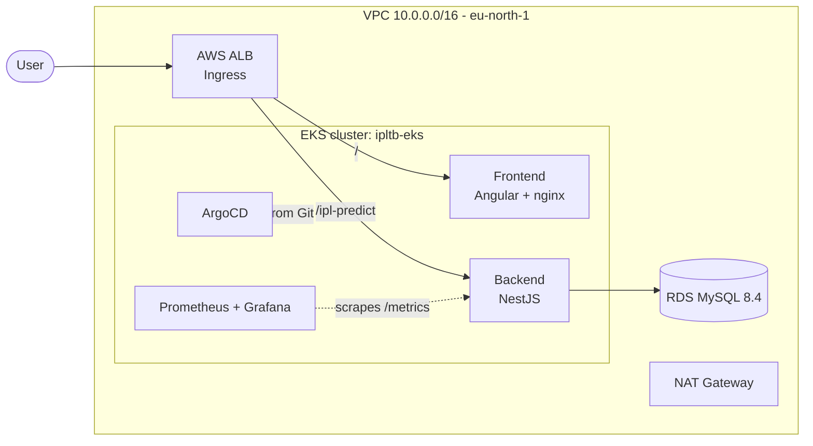

# fp-infra

Infrastructure for **IPLTB** (IPL predictions app) — AWS infrastructure with Terraform, Kubernetes deployment with Helm and ArgoCD, Docker image builds, and monitoring with Prometheus and Grafana.

The application source code lives in a separate repository: [matanmou/fp-app](https://github.com/matanmou/fp-app) (Angular frontend + NestJS backend).

## Architecture



- **Networking** — VPC with 2 public subnets (ALB, NAT) and 2 private subnets (EKS nodes, RDS) across 2 AZs.
- **Compute** — EKS with a managed node group (`t3.medium`, ON_DEMAND, 1–3 nodes).
- **Database** — RDS MySQL (`db.t4g.micro`), private, reachable only from the EKS cluster security group. The master password is managed by AWS Secrets Manager.
- **IAM for pods** — EKS Pod Identity for the AWS Load Balancer Controller and the EBS CSI driver.
- **Delivery** — GitHub Actions builds images to Docker Hub; ArgoCD deploys the Helm chart from this repo.

## Repository structure

```
.
├── .github/workflows/       # Reusable workflows called from fp-app CI/CD
│   ├── backend.yaml         #   build & push matanmo93/fp-backend
│   └── frontend.yaml        #   build & push matanmo93/fp-frontend
├── Docker/
│   ├── backend/Dockerfile   # Multi-stage: clone fp-app/backend -> build -> node:22-alpine
│   └── frontend/Dockerfile  # Multi-stage: clone fp-app/frontend -> ng build -> nginx
├── Helm/
│   ├── ipltb/               # Application chart (frontend, backend, ingress, optional MySQL)
│   │   ├── values.yaml          # defaults (local MySQL, nginx ingress)
│   │   ├── values-local.yaml    # local cluster overrides
│   │   └── values-aws.yaml      # AWS overrides (RDS, ALB, metrics)
│   ├── monitoring/          # kube-prometheus-stack values + gp3 StorageClass
│   └── argocd/              # ArgoCD Application manifests
│       ├── ipltb-app.yaml       # local
│       ├── ipltb-app-aws.yaml   # AWS
│       └── monitoring-app.yaml  # Prometheus + Grafana
└── Terraform/               # VPC, subnets, NAT, IGW, routes, SGs, EKS, IAM, RDS
```

## Prerequisites

- AWS account and an IAM user with the required permissions
- [Terraform](https://developer.hashicorp.com/terraform/install) >= 1.5
- [AWS CLI](https://docs.aws.amazon.com/cli/latest/userguide/getting-started-install.html) v2
- [kubectl](https://kubernetes.io/docs/tasks/tools/) and [Helm](https://helm.sh/docs/intro/install/) v3
- `jq`

## Deploying to AWS

### 1. Provision infrastructure

```bash
cd Terraform
terraform init
terraform plan
terraform apply
```

Main variables (see `variables.tf`):

| Variable | Default | Description |
|---|---|---|
| `aws_region` | `eu-north-1` | AWS region |
| `project_name` | `ipltb` | Prefix for resource names |
| `node_instance_type` | `t3.medium` | EKS worker instance type |
| `node_desired_size` / `min` / `max` | `2` / `1` / `3` | Node group scaling |
| `db_name` / `db_username` | `ipldb` / `matanmo` | RDS database and user |
| `console_admin_arn` | — | IAM principal granted EKS cluster admin |

### 2. Connect kubectl

```bash
aws eks update-kubeconfig --region eu-north-1 --name ipltb-eks
kubectl get nodes
```

### 3. Install the AWS Load Balancer Controller

The IAM role and Pod Identity association are created by Terraform; install the controller itself with Helm:

```bash
helm repo add eks https://aws.github.io/eks-charts
helm repo update
helm install aws-load-balancer-controller eks/aws-load-balancer-controller \
  -n kube-system \
  --set clusterName=ipltb-eks \
  --set serviceAccount.name=aws-load-balancer-controller \
  --set region=eu-north-1 \
  --set vpcId=$(terraform -chdir=Terraform output -raw vpc_id)
```

### 4. Install ArgoCD

```bash
kubectl create namespace argocd
kubectl apply -n argocd -f https://raw.githubusercontent.com/argoproj/argo-cd/stable/manifests/install.yaml
```

### 5. Create the database secret

The RDS password is stored in Secrets Manager. Copy it into a Kubernetes secret:

```bash
SECRET_ARN=$(terraform -chdir=Terraform output -raw rds_secret_arn)
DB_PASS=$(aws secretsmanager get-secret-value --secret-id "$SECRET_ARN" \
  --query SecretString --output text | jq -r .password)

kubectl create namespace ipltb-space
kubectl create secret generic ipltb-secret -n ipltb-space \
  --from-literal=MYSQL_PASSWORD="$DB_PASS"
unset DB_PASS
```

### 6. Deploy monitoring

```bash
kubectl apply -f Helm/monitoring/storageclass.yaml

kubectl create namespace monitoring
read -s -p "Grafana admin password: " GF_PASS; echo
kubectl create secret generic grafana-admin -n monitoring \
  --from-literal=admin-user=admin --from-literal=admin-password="$GF_PASS"
unset GF_PASS

kubectl apply -f Helm/argocd/monitoring-app.yaml
```

> Deploy monitoring **before** the application: the app chart creates a `ServiceMonitor`, which requires the Prometheus Operator CRDs.

### 7. Deploy the application

Make sure `backend.dbHost` in `Helm/argocd/ipltb-app-aws.yaml` matches the current RDS endpoint:

```bash
terraform -chdir=Terraform output -raw rds_endpoint
```

Then:

```bash
kubectl apply -f Helm/argocd/ipltb-app-aws.yaml
kubectl get ingress -n ipltb-space   # the ADDRESS column is the public ALB URL
```

## Monitoring

Monitoring is based on [kube-prometheus-stack](https://github.com/prometheus-community/helm-charts/tree/main/charts/kube-prometheus-stack), deployed via ArgoCD.

- Prometheus retention: 7 days, 10Gi gp3 volume
- Grafana: 5Gi gp3 volume, admin credentials from the `grafana-admin` secret
- Alertmanager and EKS-managed control-plane scraping are disabled
- The backend exposes `/metrics` (via `prom-client`) and is scraped through a `ServiceMonitor` when `backend.metrics.enabled=true` (set in `values-aws.yaml`)

Access via port-forward:

```bash
kubectl port-forward -n monitoring svc/monitoring-grafana 3000:80
# http://localhost:3000

kubectl port-forward -n monitoring svc/monitoring-kube-prometheus-prometheus 9090:9090
# http://localhost:9090/targets
```

Useful PromQL queries:

```promql
sum(rate(http_requests_total{namespace="ipltb-space"}[5m])) by (route)
histogram_quantile(0.95, sum(rate(http_request_duration_seconds_bucket[5m])) by (le, route))
```

## Running locally

For a local cluster (minikube, kind, Docker Desktop) with an nginx ingress controller. The chart runs its own MySQL in this mode.

Create `Helm/ipltb/secrets.yaml` (git-ignored):

```yaml
mysql:
  rootPassword: "<root-password>"
  password: "<user-password>"
```

Install with Helm:

```bash
helm install ipltb Helm/ipltb -n ipltb-space --create-namespace \
  -f Helm/ipltb/values-local.yaml -f Helm/ipltb/secrets.yaml
```

Or with ArgoCD (`Helm/argocd/ipltb-app.yaml`), after creating `ipltb-secret` manually in `ipltb-space`.

## CI/CD

1. A push to [fp-app](https://github.com/matanmou/fp-app) triggers its pipeline, which calls the reusable workflows in `.github/workflows/`.
2. The workflow builds the image from `Docker/backend` or `Docker/frontend` (the Dockerfile clones the app source) and pushes it to Docker Hub as `:latest` and `:<commit-sha>`.
3. ArgoCD watches `main` in this repo and syncs any change in `Helm/` to the cluster automatically (`prune` + `selfHeal`).

Required secret in fp-app: `DOCKERHUB_TOKEN`.

## Teardown

Delete Kubernetes resources that created AWS resources outside Terraform **first**, otherwise the ALB and EBS volumes will be left behind and block or outlive `terraform destroy`:

```bash
kubectl delete -f Helm/argocd/ipltb-app-aws.yaml      # removes the ALB
kubectl delete -f Helm/argocd/monitoring-app.yaml
kubectl delete pvc --all -n monitoring                # removes EBS volumes

cd Terraform
terraform destroy
```
